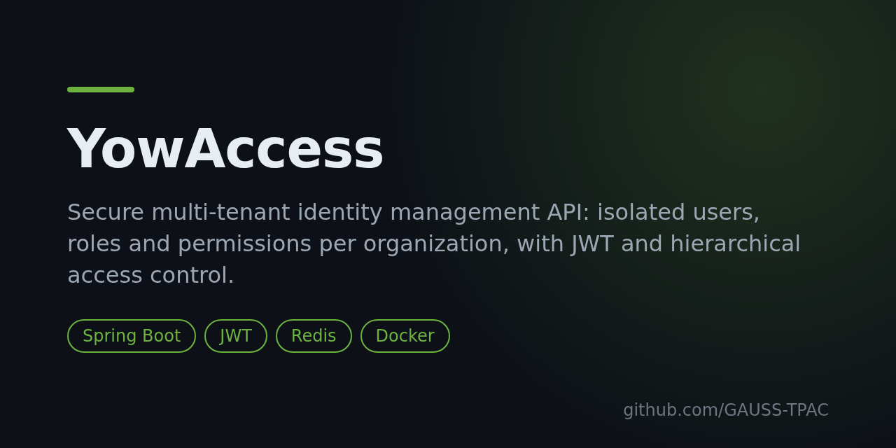

# YowAccess



[](LICENSE)
[](https://github.com/GAUSS-TPAC/yowyob--Access/releases)


A secure, **LDAP-like multi-tenant identity management API**. Each organization (tenant) gets isolated users, roles and permissions, so access is governed independently per organization. The tenant admin creates the roles and defines, per role, what each one may see and do.

## Features

- **Per-tenant isolation** of users, roles and permissions.
- **Admin-defined roles**: a tenant admin creates roles and assigns permissions; users then see only what their role allows.
- **Scalable, hierarchical access model**, with Redis for fast permission/session lookups.
- **Audit logging** of actions across tenants, users and resources.
- **Super-admin / tenant-admin separation** for platform vs organization governance.

## Tech stack

Spring Boot 3.5 · Java 21 · Spring Data JPA · Spring Data Redis · PostgreSQL · Docker Compose · Next.js front end.

## Run with Docker

```bash
git clone https://github.com/GAUSS-TPAC/yowyob--Access.git
cd yowyob--Access
docker compose up --build
```

This starts PostgreSQL, Redis and the backend. The database is seeded from [`scripts/`](scripts/).

## Run the backend alone

```bash
cd access
# set DATABASE_URL, JWT_SECRET, APP_BASE_URL
./mvnw spring-boot:run        # http://localhost:8080
```

## Documentation

The formal specification and constraints are in [`Docs yow-access/`](Docs%20yow-access/): the requirements (cahier des charges), the development/technology charter, and a short `context.md`.

> This is a learning/portfolio implementation of the YowAccess spec. For a self-contained variant with hierarchical resources and Liquibase migrations, see the sibling project [Access-RBAC-MULTI-TENANCY-](https://github.com/GAUSS-TPAC/Access-RBAC-MULTI-TENANCY-).

## Contributing

Issues and pull requests welcome. A ⭐ helps others find the project.

## License

[MIT](LICENSE) © GAUSS-TPAC
